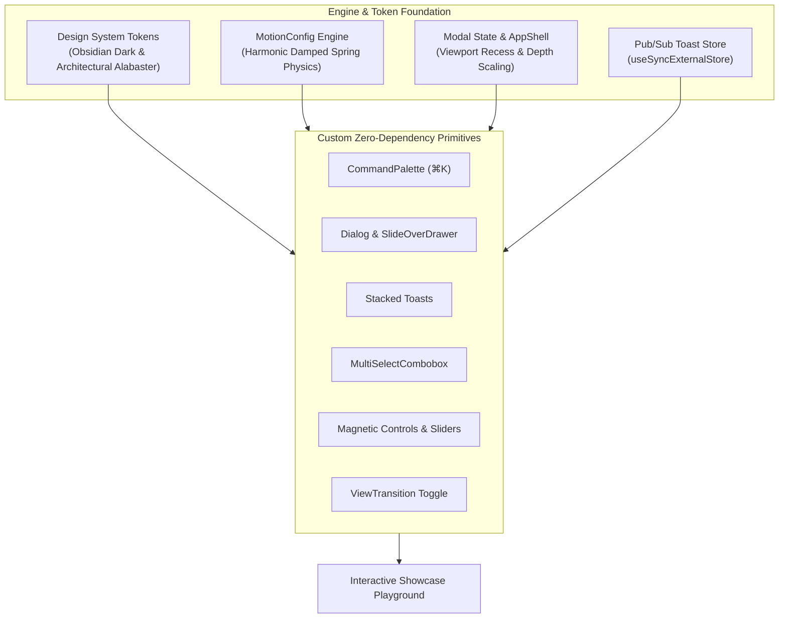

<div align="center">

# ⚡ KinetixUI
### Precision React Primitives & Motion Physics Playground

[](https://reactjs.org/)
[](https://www.typescriptlang.org/)
[](https://tailwindcss.com/)
[](https://www.framer.com/motion/)
[](#-zero-dependency-architecture)
[](#-keyboard-navigation--wai-aria-matrix)
[](LICENSE)

<p align="center">
  <strong>A keyboard-first, zero-headless-dependency React + TypeScript UI primitive library and interactive design-engineering showcase.</strong><br />
  Engineered to Principal Design Engineer caliber (Linear / Vercel / Raycast / Rauno Freiberg level craft).
</p>

</div>

---

## 🎯 The Philosophy & The Bar

Most modern web apps rely on third-party headless bundles with heavy runtime wrappers, generic cartoon bounce curves, and neon glow effects.

**KinetixUI was built to prove what is possible when UI primitives are engineered from first principles:**
- **ZERO external headless libraries**: Every focus trap, ARIA activedescendant, toast queue, fuzzy scorer, and portal is engineered cleanly from scratch in `/src/primitives/` (0 Radix, 0 Headless UI, 0 cmdk, 0 sonner).
- **ZERO layout shifts**: Dynamic scrollbar gap compensation (`window.innerWidth - clientWidth`) applied to `paddingRight` completely eliminates viewport jumping when modals or drawers open.
- **ZERO default browser outlines**: Double-ring `:focus-visible` treatments (`0 0 0 2px var(--bg-canvas), 0 0 0 4px var(--focus-ring)`).
- **Harmonic Spring Physics**: Damped oscillator trajectory scaling that preserves exact mathematical curves in **0.25× Slow-Mo**.

---

## 🏛️ System Architecture



---

## 🔬 Core Primitives & Engineering Craft

### 1. Command Palette (`⌘K` / `Ctrl+K`)
- **Fuzzy Search Engine**: Deterministic custom fuzzy matcher (`fuzzyMatch.ts`) scoring word boundaries, camelCase transitions, and consecutive matches. Matched characters render bold with an underline in `--accent-signal`.
- **Nested Page Stack**: Multi-level drill-down support (`Root -> Theme -> Motion Speed`). Selecting a command slides into a nested sub-page with breadcrumbs (`x: 24 -> 0`); pressing `Backspace` on an empty query pops back.
- **Full ARIA Wiring**: `role="dialog"`, `role="combobox"`, `role="listbox"`, `aria-activedescendant`, wrapping arrow navigation, and live result count badge.
- **Keycaps Footer**: Physical bottom footer with interactive `↑↓ Navigate · ↵ Select · ⌫ Back · ESC Close` caps.

### 2. Viewport Depth-Scaling Dialog & Drawer
- **Custom `useFocusTrap`**: Queries focusable elements, wraps `Tab`/`Shift+Tab`, blocks background interaction, and deterministically restores focus to the triggering element on close.
- **Viewport Recess**: When any modal or drawer is active, the entire background `<AppShell>` smoothly scales to `scale: 0.982`, rounds corners to `14px`, and dims to `0.75` brightness.
- **Slide-Over Drawer**: Left-edge vertical drag pill handle with velocity-threshold swipe-to-dismiss ($> 400\text{px/s}$ or offset $> 100\text{px}$).

### 3. Stacked Toast Notification Engine
- **`useSyncExternalStore`**: External pub/sub store guarantees that triggering `toast.show(...)` causes **0 re-renders** across the application.
- **Physical Depth Stacking**:
  - Front toast: `y: 0px, scale: 1.00, opacity: 1.00`
  - 2nd toast: `y: -12px, scale: 0.95, opacity: 0.85`
  - 3rd toast: `y: -24px, scale: 0.90, opacity: 0.65`
- **Hover Fan-Out**: Hovering over the stack spreads toasts with `10px` vertical gaps and freezes the hairline 2px countdown progress bar.
- **Pointer Swipe-to-Dismiss**: Flings away when dragged horizontally. Includes interactive **Undo** callbacks.

### 4. PopLayout Multi-Select Combobox
- **Animated Tag Pills**: Rendered with Framer Motion `AnimatePresence mode="popLayout"`, gliding smoothly into position when tags are deleted.
- **Pro-App Backspace UX**: When the query input is empty, the 1st `Backspace` highlights the last pill in warning red; a 2nd `Backspace` removes it.
- **Dynamic Creation**: Typing an unmatched keyword instantly offers `+ Create "XYZ"`.

### 5. View Transitions API Theme Toggle
- Uses native `document.startViewTransition()` to expand a circular clip-path mask anchored to the click origin:
  $$\text{radius}_{\max} = \sqrt{\max(x, W - x)^2 + \max(y, H - y)^2}$$
- Seamlessly morphs between **Obsidian Dark** (`#08080A`) and **Architectural Alabaster** (`#FAFAFB`) over `520ms` (`cubic-bezier(0.22, 1, 0.36, 1)`).

### 6. Magnetic Segmented Control & Precision Slider
- **Segmented Control**: Shared-element `layoutId` pill with crisp specular catch, Left/Right arrow navigation, and magnetic hover tracking.
- **Precision Slider**: Fully accessible `role="slider"` with tick marks, floating monospace tooltip, and tactile thumb compression feedback (`scale: 0.90`).

---

## 📐 Mathematical Harmonic Slow-Motion Scaling

In a damped harmonic oscillator:
$$\omega_0 = \sqrt{\frac{k}{m}}, \quad \zeta = \frac{c}{2\sqrt{km}}$$
When testing motion in **0.25× Slow-Mo**, naive duration overrides alter spring characteristics. To slow time down by a factor $\alpha = \text{timeScale} = 0.25$ while preserving the **exact physical trajectory**:
$$k_{\text{eff}} = \alpha^2 k, \quad c_{\text{eff}} = \alpha c, \quad m_{\text{eff}} = m$$
This maintains identical damping ratio $\zeta' = \zeta$ and scales frequency $\omega' = \alpha \omega_0$, allowing frame-by-frame visual inspection of motion curves.

---

## 🎨 Design System Tokens (`src/styles/tokens.css`)

| Token | Obsidian Dark (`:root`) | Alabaster Light (`[data-theme="light"]`) | Usage |
| :--- | :--- | :--- | :--- |
| `--bg-canvas` | `#08080A` | `#FAFAFB` | Root viewport canvas |
| `--bg-surface` | `#101013` | `#FFFFFF` | Primary cards, dialogs, command palette |
| `--bg-surface-elevated` | `#16161A` | `#F4F4F6` | Nested controls, hover rows, inputs |
| `--bg-surface-active` | `#1E1E24` | `#EAEAEF` | Pressed states, active selection rows |
| `--border-subtle` | `rgba(255,255,255,0.07)` | `rgba(9,9,11,0.08)` | Hairline `1px` container borders |
| `--border-strong` | `rgba(255,255,255,0.14)` | `rgba(9,9,11,0.16)` | Interactive control borders & focus hover |
| `--specular-top` | `inset 0 1px 0 0 rgba(255,255,255,0.07)` | `inset 0 1px 0 0 rgba(255,255,255,0.9)` | Metallic light catch on top edges |
| `--text-primary` | `#F4F4F6` | `#09090B` | Headings, active items |
| `--text-secondary` | `#A1A1AA` | `#52525B` | Body copy, descriptions |
| `--text-tertiary` | `#63636E` | `#8E8E98` | Micro-labels, shortcut hints |
| `--accent` | `#E4E4E7` | `#18181B` | Primary high-contrast monochrome CTA |
| `--accent-signal` | `#3B82F6` | `#2563EB` | Focus rings, active sliders, sparklines |

---

## ⌨️ Keyboard Navigation & WAI-ARIA Matrix

| Shortcut | Scope | Engineered Behavior |
| :--- | :--- | :--- |
| `⌘K` / `Ctrl+K` | Global | Toggles Command Palette from anywhere |
| `Tab` / `Shift+Tab` | Dialog / Drawer | Traps focus strictly within modal bounds; wraps cleanly |
| `↑` / `↓` | Palette / Combobox | Navigates options with wrapping; auto-scrolls into view |
| `↵ Enter` | Palette / Combobox | Executes command, drills into nested page, or selects tag |
| `⌫ Backspace` | Palette (empty input) | Pops nested sub-page back to parent page |
| `⌫ Backspace` | Combobox (empty query)| 1st press highlights last pill; 2nd press deletes it |
| `ESC` | Modals / Drawers | Pops page or dismisses overlay; restores previous focus |
| `←` / `→` | Segmented Control | Adjusts active selection with shared `layoutId` pill |
| `←` / `→` / `↑` / `↓` | Precision Slider | Steps value by precision increment |
| `PageUp` / `PageDown` | Precision Slider | Steps value by 10× increment |
| `Home` / `End` | Precision Slider | Snaps slider to minimum or maximum bound |

---

## 📂 Project Directory Structure

```
c:\Users\heman\OneDrive\Desktop\KinetixUI\
├── index.html
├── package.json
├── tsconfig.json
├── vite.config.ts
├── tailwind.config.js
├── src/
│   ├── main.tsx
│   ├── App.tsx
│   ├── index.css
│   ├── styles/
│   │   └── tokens.css
│   ├── context/
│   │   ├── MotionConfigContext.tsx      # Physics spring engine & timeScale
│   │   ├── ThemeContext.tsx             # View Transitions circular clip-path
│   │   └── ModalContext.tsx             # Viewport depth scaling state
│   ├── hooks/
│   │   ├── useFocusTrap.ts              # Deterministic WAI-ARIA focus trap
│   │   └── useScrollLock.ts             # Zero-layout-shift scroll lock
│   ├── primitives/
│   │   ├── CommandPalette/              # Fuzzy search & nested page stack
│   │   ├── Dialog/                      # Modal & Slide-Over Drawer
│   │   ├── Toast/                       # useSyncExternalStore stacked toasts
│   │   ├── MultiSelectCombobox/         # PopLayout tag pills & backspace UX
│   │   ├── ViewTransitionThemeToggle/   # View Transitions theme switcher
│   │   └── Controls/                    # Segmented control & Precision slider
│   └── components/
│       ├── Header.tsx                   # Sticky blurred hairline header
│       ├── HeroSection.tsx              # Blur-to-sharp typography & grid
│       ├── KeycapStrip.tsx              # Hardware-synced interactive keycaps
│       ├── PhysicsInspectorDock.tsx     # Floating speed & spring controls
│       ├── SpringSparkline.tsx          # Real-time harmonic response curve
│       ├── SpotlightCard.tsx            # Specular perimeter spotlight
│       ├── ComponentStage.tsx           # Preview, TSX Code, A11y Spec tabs
│       ├── A11yMonitor.tsx              # Live telemetry focus HUD
│       └── AppShell.tsx                 # Viewport scaling container
└── README.md
```

---

## 🚀 Getting Started

### Prerequisites
- Node.js 18+
- npm or pnpm

### Installation
```bash
# Clone the repository
git clone https://github.com/hemanthkumarha07-debug/Kinetix-UI.git
cd Kinetix-UI

# Install dependencies
npm install

# Start local dev server
npm run dev
# -> http://localhost:5173/
```

### Verification Commands
```bash
# Strict TypeScript check (0 errors permitted)
npx tsc --noEmit

# Production bundle compilation
npm run build
```

---

## 📄 License

MIT © [hemanthkumarha07-debug](https://github.com/hemanthkumarha07-debug)
